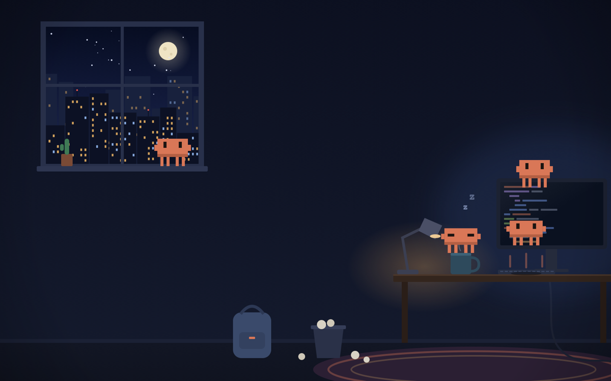

# claude-themes

Backdrop themes for the Claude Code tab of the Claude desktop app.

## Night Room



A dark theme: a coder's room at night. A window looks out on a sleeping city, and the desk has a lamp, a monitor and a mug. Four orange pixel critters live there. One jumps over the desk, one sits on the monitor, one sleeps on the mug, and one watches the moon from the windowsill.

The interface takes the same night-blue colours, with orange accents to match the critters.

The critters react to two things:

- **A failed command:** they fall over with their legs in the air and get back up after a few seconds.
- **"merged" in Claude's reply:** fireworks over the city, confetti, and everyone jumps.

### Install

In a Claude Code terminal session:

```
/plugin install night-room --marketplace T3NSA1/claude-themes
```

From a shell:

```bash
claude plugin install night-room --marketplace T3NSA1/claude-themes
```

In the desktop app, click **+** next to the prompt box, choose **Plugins**, then **Add marketplace** with `T3NSA1/claude-themes`, and add **night-room**.

The theme shows up in the next session, after your first message.

### Notes

- It draws only in the desktop app (the Code tab) and the mobile app. A terminal has no backdrop.
- When "Reduce motion" is on in your system settings, the scene stays still.
- Only one theme can show at a time. If another theme plugin is active, turn it off first.

### Turning everyday reactions on

By default the room does not change while Claude works, because each change reloads the picture and makes the window flash for a moment. If you don't mind that, set `CALM` to `false` in `night-room/hooks/register.tsx`. The critters then run about while Claude thinks and one types at the keyboard while commands run.

## License

MIT
